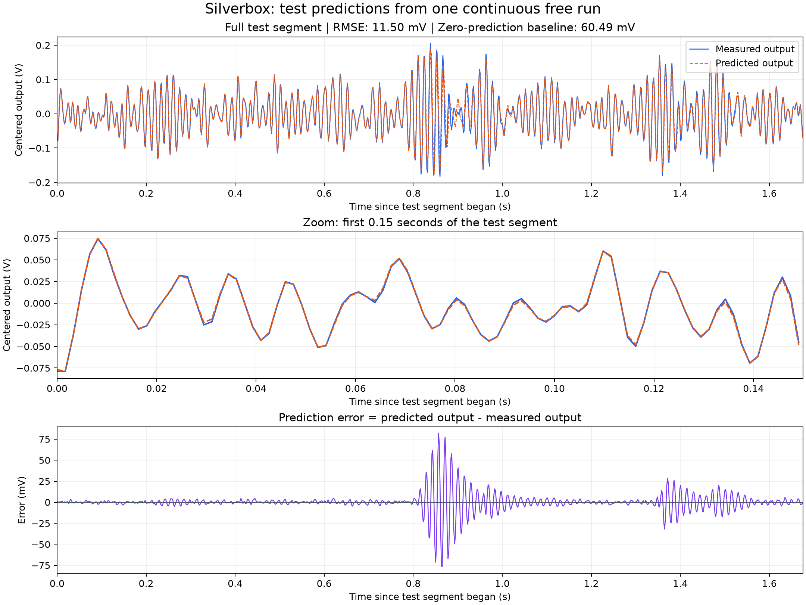

# Neural Dynamics Modeling of the Silverbox Oscillator

A PyTorch implementation of a neural acceleration model for the Silverbox
nonlinear oscillator. The model combines a learned acceleration function with
an explicit state equation and fourth-order Runge-Kutta integration to simulate
the measured output from the applied input voltage.

The repository includes training and evaluation scripts, ten completed
experiments, saved model weights, prediction traces, and a
[technical report](output/pdf/task5_report.pdf).

## Results

The selected model uses two hidden layers of 64 neurons and 4,481 trainable
parameters. Its saved checkpoint reproduces the following continuous free-run
results:

| Metric | Value |
|---|---:|
| Training RMSE | 2.914 mV |
| Test RMSE | 11.498 mV |
| Zero-prediction test RMSE | 60.492 mV |
| Test RMSE reduction relative to the zero baseline | 81.0% |

RMSE measures the root mean squared difference between predicted and measured
output voltage. Lower values indicate closer agreement.



The model is selected by the lowest test RMSE across the completed experiments.
Consequently, the reported test record also serves for model selection; it is
not an independent final holdout. Measured test outputs are not used in gradient
updates or as state corrections during simulation.

## Method

The network receives the state and input in the order `[y, v, u]` and predicts
one acceleration value, `alpha_theta(y, v, u)`. Hidden layers use Tanh
activations, and the output layer is linear. The resulting state equation is:

```text
dy/dt = v
dv/dt = alpha_theta(y, v, u)
```

RK4 advances this state at the dataset's sampling interval, with linear
interpolation of the known input between adjacent samples. Input and
acceleration scales are estimated from training-only RMS magnitudes.

Training minimizes position MSE over randomly sampled windows contained entirely
within the training record. Each window starts from its measured position and
a finite-difference velocity estimate. Subsequent states are obtained by
integration, and gradients propagate through the RK4 simulation.

Evaluation uses one continuous simulation across the full record. It starts
from the first training sample and carries the predicted state across the
training/test boundary without resetting it.

## Data

The included [`SNLS80mV.mat`](data/SNLS80mV.mat) record contains the Silverbox
input voltage in channel `V1` and output voltage in channel `V2`.

| Property | Value |
|---|---|
| Sampling frequency | 610.35 Hz |
| Selected Python slice | `[42650:46746]` |
| Record length | 4,096 samples |
| Training segment | First 3,072 samples |
| Test segment | Last 1,024 samples |

Each signal is centered using its mean over the full selected excerpt. This
preprocessing uses the full record, including the test segment. The additional
RMS scales used by the network are computed only from training data.

## Installation

Use Python 3.12. From the repository root, create a virtual environment and
install the recorded dependencies:

```sh
python3.12 -m venv .venv
.venv/bin/python -m pip install -r requirements.txt
```

## Usage

### Evaluate the saved model

```sh
.venv/bin/python src/test.py
```

This loads `output/best_model.pt`, reports training and test RMSE, and saves and
displays a new comparison plot. Use `--no-show` to save the plot without opening
a window. To evaluate another checkpoint:

```sh
.venv/bin/python src/test.py --checkpoint path/to/model.pt --no-show
```

### Train a baseline model

```sh
.venv/bin/python src/train.py
```

The baseline uses hidden widths `(32, 32)`, Adam with learning rate `0.01`,
3,000 updates, and 64-sample training windows. Each launch trains a new model,
reports loss and timing information, and saves a timestamped test plot. Close
the displayed plot window to let the script finish.

### Run the experiment comparison

```sh
.venv/bin/python src/experiments.py
```

The comparison evaluates `(32, 32)`, `(64, 64)`, and `(32, 32, 32)` architectures
under three training configurations each, plus the baseline's original random
sampling sequence. Configurations, loss histories, checkpoints, timing, and
RMSE are saved to a timestamped directory under `output/experiments/`.
The run with the lowest test RMSE updates the selected checkpoint and prediction
artifacts under `output/`.

The selected configuration is:

| Setting | Value |
|---|---|
| Optimizer | AdamW |
| Learning rate | 0.003 |
| Weight decay | 0.0001 |
| Optimizer updates | 3,000 |
| Rollout length | 128 samples |
| Batch size | 8 windows |
| Weight initialization seed | 0 |
| Window sampling seed | 1 |

See the [complete experiment table](output/experiments/20261011_220640/results.csv)
for the recorded comparison.

### Run verification checks

```sh
.venv/bin/python -m unittest discover -s tests -v
```

The checks verify checkpoint restoration, continuous state propagation, and
that changing measured test outputs changes the score without changing the
predicted trajectory.

### Generate the technical report

```sh
.venv/bin/python -m pip install -r requirements-report.txt
.venv/bin/python src/build_report.py --repository-url https://github.com/WhoEvenAm/Physics-Informed-Neural-Network-for-the-Silverbox-oscillator
```

The report is generated from saved experiment results and prediction artifacts
under `output/pdf/`. Omitting the repository URL produces a draft.

## Repository structure

| Path | Purpose |
|---|---|
| `src/data_loader.py` | Data extraction, centering, and chronological splitting |
| `src/src/silverbox_model.py` | Acceleration network, state derivative, and RK4 rollout |
| `src/train.py` | Baseline training and prediction plots |
| `src/training_utils.py` | Shared training, evaluation, and checkpoint utilities |
| `src/experiments.py` | Architecture and training-configuration comparison |
| `src/test.py` | Evaluation of saved checkpoints |
| `src/build_report.py` | PDF report generation |
| `tests/` | Evaluation and checkpoint verification |
| `output/` | Saved models, results, prediction traces, and report |
